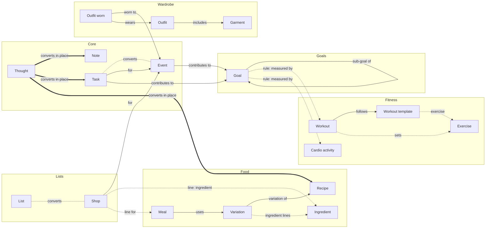
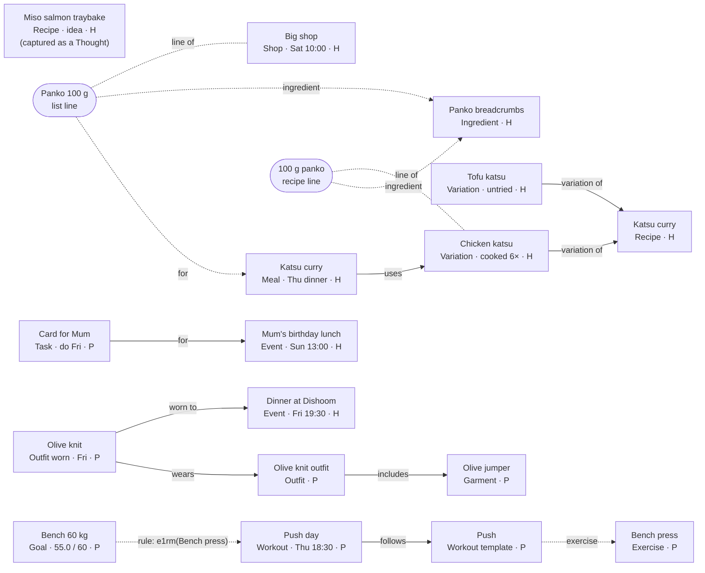

# Data model

*Written by hand until the ontology package generates it
([ADR-0036](adr/0036-changing-the-model-over-time.md)). The core Types
(Thought, Note, Task, Event), their link types and conversions are already
declared in [`packages/ontology`](../../packages/ontology/src/), which is the
authority for them; this document must agree with it. The shape is
Provisionally agreed, through the ADRs it cites; column-level detail is a
draft that each stage's spec confirms. Types for later stages are listed so
the whole shape is visible; each is built only in its own stage.*

## Three mechanisms

*([ADR-0005](adr/0005-traits-links-rules.md), Provisionally agreed)*

1. **Traits — what an Item *is*.** Types have traits: *Schedulable* (has a
   time), *Completable* (can be ticked off), *Shareable* (can belong to the
   Household Space), *Capturable* (a Thought can become one in place).
   **Views are queries over traits.** Plan = Schedulable Items in a date
   range; the Gym View = Items of workout Types. A new Schedulable Type
   appears on Plan with no extra work. ("Gym session *can be viewed on* Plan"
   is therefore a query, not a link.) There is no *Measurable* trait: what
   goals can measure is the measures registry's job.
2. **Links — how two specific Items relate.** Named in both directions
   ("uses" / "used in"), with rules about which Types each link type may
   connect, like a DOORS link module.
3. **Rules — relationships that are calculated, not stored.** A goal like
   *Bench 60 kg* holds a measurement rule (best estimated 1RM for bench
   press); its contributing sessions are whatever the rule finds. Nobody links
   sessions to goals by hand.

**The action creates the link.** Converting a Thought keeps the same Item, so no
link is needed; *became* is created only when a new Item is made from an old
one.

## Concepts at a glance

| Concept | What it is | Stored as |
|---|---|---|
| Item | A node in the graph | `core.items` + a detail table per Type |
| Type | What kind of Item | Code constant, copied to a lookup table |
| Trait | A capability of a Type | Part of the Type's declaration |
| Status | `idea · active · done · cancelled`, labelled per Type | `core.items.status` |
| Link / link type | A named edge between two Items | `core.links` + code constant |
| Child row | Part of one Item, not an Item | Module tables |
| Reference data | A Module's lookup list (muscle groups, cuisines, brands…) | Module lookup tables |
| Label | A per-Space grouping on any Item: Task groups, Note headings | `core.labels`, `core.item_labels` |
| Series | A repeat rule that generates occurrences | `core.series` |
| Reminder | A per-person notification on an Item | `core.reminders` |
| Space | Personal or Household | `core.spaces`, `core.space_members` |
| Measure | Something a goal can track | SQL function named in code |
| View / Screen | A query + layout / a workflow page | Code |
| Integration | An outside source | `core.connections`, `core.external_refs` |
| Activity | What happened to which Item, when | `core.activity` (triggers) |

## Storage shape

*([ADR-0007](adr/0007-storage-shape.md), Provisionally agreed)*

A shared core table plus per-type detail tables ("class table inheritance"),
modelled in ordinary Postgres tables plus a links table:

```
core.items     id (UUIDv7, made on the device), type, title, body, space_id,
               owner_id, status, starts_at, ends_at, all_day, due_on (date),
               do_on (date) + do_at (optional time), slot, series_id,
               touched_at, created_at, updated_at, archived_at
               (only the fields every View filters on)

<type> detail  1:1 with items, per Type, in its Module's schema, e.g.
               fitness.workout(item_id, actual_start, duration, readiness …)
               food.meal(item_id, servings)
               lists.shop(item_id, place)

child rows     belong to one Item and are not Items themselves:
               workout_sets, variation_ingredients, list_lines …

core.series    the repeat rule, mode (schedule | after completion), start,
               timezone, generated_until, template fields
core.links     from_item, to_item, link_type, origin (manual|action|integration) …
core.reminders item_id, person, anchor (starts_at|do_on|due_on) + offset, or a
               fixed time; fires_at (calculated); snoozed_until
core.activity  item_id, verb, changed (jsonb), at, actor — written by triggers
```

- **Types, link types and measures are declared in code**; a generated
  migration copies Types and link types into lookup tables so the database
  can enforce which Types a link may connect
  ([ADR-0008](adr/0008-registries-declared-in-code.md)).
- **Status is one small core set:** `idea | active | done | cancelled`. Each
  Type uses the subset that applies, with its own labels. Finer states, such
  as a workout in progress, live in the detail table. Only Completable Types
  use *done*.
- **IDs are made on the device** (UUIDv7, so they sort by creation time).
  Postgres 17 has no built-in `uuidv7()`, so server-side inserts use a small
  SQL function.
- **`do_on` is a date with an optional time.** A Task is something *you do*,
  by or on a date; an Event is something that *happens* at a time. "Sat 10:00
  Tesco" is a Shop with a do-on time; "Dishoom 19:30" is an Event.
- **`touched_at`** is set the first time an occurrence is edited, ticked,
  logged or linked ([ADR-0022](adr/0022-repeating-items.md)).
- **Writes that span tables are database functions** called over RPC
  ([ADR-0009](adr/0009-cross-table-writes-are-database-functions.md));
  [ADR-0042](adr/0042-data-layer.md) makes every write one.

### Time fields per Schedulable Type

Plan shows an Item on the first of these it has: `starts_at` (as a local
date), `do_on`, `due_on`. A `CHECK` per Type refuses the fields it doesn't
use.

| Type | Time fields | Reminder anchors |
|---|---|---|
| Task | `do_on` + `do_at`, `due_on` | `do_on`, `due_on` |
| Event | `starts_at`, `ends_at`, `all_day` | `starts_at` |
| Shop | `do_on` + `do_at` | `do_on` |
| Meal | `do_on` + `slot` | `do_on` |
| Workout, Cardio activity | `starts_at` (planned; what happened is in the detail table) | `starts_at` |
| Outfit worn | `do_on` | `do_on` |
| Goal | none: its deadline is in `goals.goal`, so a Goal is not on Plan | — |

Task ↔ Event maps `do_on` + `do_at` to `starts_at` (all-day when there is no
time); List → Shop gains a `do_on`.

## Item or child row?

An Item if it needs to be **linked, scheduled, shared or searched on its
own**; otherwise a child row. A child row may *point at* an Item without being
one: a set points at its Exercise; a recipe line points at its Ingredient; a
list line can point at both the Ingredient it is and the Meal it is for
("Panko · for Katsu, Thu"). Garments are Items, because outfits link to them.
Ingredients are Items for the same reason Exercises are: many lines point at
the same one.

## Definition → occurrence

*([ADR-0013](adr/0013-occurrences-snapshot-their-definition.md), Provisionally agreed)*

| Definition | Occurrence | Link | Snapshot copied |
|---|---|---|---|
| Variation (of a Recipe) | Meal | *uses* | Servings and, once added to a list, the scaled quantities on its list lines |
| Workout template | Workout | *follows* | Each exercise's targets, at the start of the session |
| Outfit | Outfit worn on a day | *wears* | The garments in the outfit on the day |
| List template (packing) | A List for one trip | *from template* | The template's lines |
| Series (repeat rule) | Each occurrence | `series_id` | The series' fields, when generated |

Planning is mostly *creating occurrences of definitions*. History is read
from the copy, never from the definition's current values.

## Types

S = Schedulable · C = Completable · Sh = Shareable · Cap = Capturable.

| Module | Type | S | C | Sh | Cap | Default Space | Statuses used (labels) | Stage |
|---|---|---|---|---|---|---|---|---|
| core | **Thought** (raw, unsorted; waits in Inbox) | — | — | — | — | Personal | active | 2 |
| core | **Note** | — | — | — | ✓ | Personal | idea · active | 2 |
| core | **Task** | ✓ do-on / due | ✓ | ✓ | ✓ | Personal | idea "Someday" · active · done · cancelled (a missed repeat: "Skipped") | 2 |
| core | **Event** | ✓ start / end | — | ✓ | ✓ | Personal ("with household" → Household) | active · cancelled | 3 |
| lists | **List** (can be marked as a template) | — | — | ✓ | ✓ | Personal | active | 3 |
| lists | **Shop** | ✓ do-on, place | ✓ | ✓ | ✓ | Household | active · done · cancelled | 3 |
| food | **Recipe** (the dish) | — | — | ✓ | ✓ | Household | idea "Backlog" · active | 4 |
| food | **Variation** (a way of making it) | — | — | ✓ | — | Its Recipe's, always | active; *untried · attempted · final* calculated from the cook log | 4 |
| food | **Meal** | ✓ do-on + slot | ✓ "eaten" | ✓ | — | Household | active "Planned" · done · cancelled | 4 |
| food | **Ingredient** | — | — | ✓ | — | Household | active | 4 |
| fitness | **Exercise** | — | — | — | — | Personal | active | 5 |
| fitness | **Workout template** | — | — | — | — | Personal | active | 5 |
| fitness | **Workout** | ✓ start | ✓ | — | — | Personal | active "Planned" · done · cancelled "Skipped" | 5 |
| fitness | **Cardio activity** | ✓ start | ✓ | — | — | Personal | active "Planned" · done · cancelled "Skipped" | 8 (manual entry earlier if wanted) |
| goals | **Goal** | — (deadline in `goal`; not on Plan) | ✓ | ✓ | ✓ | Personal | idea · active · done "Achieved" · cancelled "Abandoned" | 5 |
| wardrobe | **Garment** | — | — | — | ✓ | Personal | idea "Wishlist" · active "Owned" · cancelled "Retired" | 6 |
| wardrobe | **Outfit** | — | — | — | — | Personal | idea · active | 6 |
| wardrobe | **Outfit worn** | ✓ do-on | ✓ "worn" | — | — | Personal | active "Planned" · done · cancelled | 6 |
| finance | **Account** | — | — | ✓ | — | Personal | active · cancelled "Closed" | 9 |

Shop and List: [ADR-0010](adr/0010-shop-is-its-own-type.md) (Provisionally agreed).
Recipe and Variation: [ADR-0011](adr/0011-recipe-and-variation.md) (Provisionally agreed).
Ingredient: [ADR-0012](adr/0012-ingredients-and-shopping-lists.md) (Provisionally agreed).

**In-place conversions:** Thought → any Capturable Type (sorting the Inbox);
Note → any other Capturable Type; Task ↔ Event; List ↔ Shop. Everything else is "create from" + *became*
([ADR-0018](adr/0018-changing-an-items-type.md), Provisionally agreed).
Thoughts and Notes: [ADR-0037](adr/0037-thoughts.md) (Provisionally agreed).

**Not Items, deliberately:** people, Spaces, series, Reminders, Labels,
reference data, list lines, ingredient lines, method steps, cook log entries,
template exercises, workout sets, health metrics (Oura sleep and readiness,
weight — a time series; [ADR-0015](adr/0015-health-data-as-a-time-series.md),
  Provisionally agreed), account balances and transactions (later).

**Possible later Types:** Place (for location Reminders and "Tesco"), Trip,
Body measurement if it ever needs linking, Project (if grouping Tasks needs
more than Labels).

## Detail tables and child rows

| Module | Detail tables (1:1 with an Item) | Child rows |
|---|---|---|
| core | — (Thought, Note, Task, Event use `core.items` only; a Note's colour and pin are columns on a small `note` table) | `task_steps` (a checklist inside a Task) |
| lists | `shop(place)` | `list_lines(text, ingredient_id?, qty, unit, section, checked, position, for_item_id?, generated, touched_at)` — used by List and Shop |
| food | `recipe(photo, cuisine, category, protein, carbs)`, `variation(servings, prep_min, cook_min, source_url, notes, final)`, `meal(servings)`, `ingredient(section, default_unit, staple)` | `variation_ingredients(ingredient_id, qty, unit, prep_note, group, position)`, `variation_steps`, `cook_log(person, cooked_on, rating, notes, meal_id?)`; reference data: cuisines, categories, protein, carbs, units |
| fitness | `exercise(muscle_groups, equipment, increment, target)`, `workout(actual_start, duration, readiness, stage)`, `cardio_activity(kind, distance_m, duration_s, avg_hr)` | `template_exercises(exercise_id, sets, reps, target)`, `workout_entries(exercise_id, snapshot)`, `workout_sets(entry_id, set_no, reps, weight, rpe)`; reference data: muscle groups, equipment, recovery settings per person |
| goals | `goal(kind, measure_key, params, target, unit, period, start_on, deadline)` | — |
| wardrobe | `garment(category, brand, colour, size, fit, photo, url, price)`, `outfit(photo)` | `outfit_worn_garments` (the snapshot); reference data: category, brand, colour, size, fit |
| health (later) | — | `daily_metrics(person, date, sleep_score, readiness, steps, weight …)` |
| finance (later) | `account(provider, kind, currency)` | `balances(date, amount)`, `transactions` |

## Link types

| Link type | From → To | Inverse label | Created by |
|---|---|---|---|
| **uses** | Meal → Variation | used in | Planning a recipe |
| **follows** | Workout → Workout template | followed by | Starting from a template |
| **wears** | Outfit worn → Outfit | worn on | Planning an outfit |
| **includes** | Outfit → Garment | in outfit | Building an outfit |
| **worn to** | Outfit worn → Event | outfit | Picking an outfit for an event |
| **for** | Task / Shop → Event | to do for | Hand, or capture ("card for mum's lunch") |
| **contributes to** | Task / Event / Shop / Workout / Cardio activity → Goal | contributors | Hand (counted only by milestone goals) |
| **sub-goal of** | Goal → Goal | sub-goals | Hand (one level) |
| **became** | any → any | came from | "Create from" |
| **variation of** | Variation → Recipe | variations | Creating a Recipe (its first Variation) or "Make a variation"; exactly one per Variation ([ADR-0011](adr/0011-recipe-and-variation.md), Provisionally agreed) |
| **from template** | List → List | made from it | "New list from template" |
| **relates to** | any ↔ any | relates to | Hand — the catch-all |

Child-row pointers that are not links: a list line's `for_item_id` (→ Meal or
Event) and `ingredient_id` (→ Ingredient), a recipe line's `ingredient_id`
(→ Ingredient), a cook log entry's `meal_id` (→ Meal), and a set's or
template line's `exercise_id` (→ Exercise). Goal measures find their Items by
rule and create no links.

## Measures (examples)

| Measure | Used by |
|---|---|
| `fitness.e1rm(exercise)` — best estimated 1RM | Target goals |
| `fitness.workouts_done(period, template?)` | Habit goals |
| `fitness.volume(exercise, period)` | Total goals |
| `cardio.distance(kind, period)` | Total goals |
| `cardio.activities(kind, period)` | Habit goals |
| `food.new_recipes_cooked(period)` — from the cook log, with or without a Meal | Total goals |
| `food.cooks(period)` — from the cook log | Habit goals |
| `core.tasks_done(period, filter?)` | Total / habit goals |
| `health.latest(metric)` (later) | Target goals (weight) |
| `finance.balance(accounts)` (later) | Target goals (ISA total) |

## Core tables

| Table | Holds |
|---|---|
| `core.people` | A person: name, home timezone, default Reminder time, Reminder defaults per Type, digest time, food preferences |
| `core.contacts` | Contact requests between people, and whether they were accepted |
| `core.spaces` · `core.space_members` · `core.space_invites` | Personal and Household Spaces, membership, invitations to a Household |
| `core.items` | Every Item |
| `core.series` | Repeat rules for generated occurrences |
| `core.links` | Every link |
| `core.reminders` · `core.reminder_deliveries` | Reminders per person; what was sent, when |
| `core.push_devices` | Web Push (later FCM) subscriptions per person |
| `core.inbox_state` | Per-person dismiss / snooze of Inbox entries |
| `core.activity` | The activity log, written by triggers |
| `core.labels` · `core.item_labels` | Labels |
| `core.stars` · `core.recent` | Per-person starred Items; recently opened Items |
| `core.capture_tokens` | Each person's capture-address secrets (hashed), revocable |
| `core.attachments` | Photos and files on Items (Supabase Storage) |
| `core.connections` | Integration connections; tokens in Vault |
| `core.external_refs` | Integration ids and raw payloads per Item |
| `core.item_types` · `core.link_types` | Lookup tables generated from the ontology package |
| `ops.events` | Errors and failures from the app, Edge Functions, cron jobs and Integrations |

## The knowledge graph, drawn

Two diagrams of the same model. In MBSE terms, the first is the **metamodel**
(which Types exist and how they may link) and the second is a **model** built
from it (one real week). A hand-drawn interactive version is frozen in
[history](../history/2026-10-09-summary-knowledge-graph.html) and not
maintained.

**Line styles:** **solid** = a stored link, created by an action ·
**dotted** = a pointer from a child row, or a Type conversion · **dashed
(`rule`)** = a goal measure, calculated, nothing stored · **thick** = a Thought
converting in place (same Item, so not a link).

### The metamodel: Types and the links allowed between them



Drawn selectively to stay readable: a Thought also converts to Event, List,
Shop, Goal and Garment (every Capturable Type), and a Note to any other
Capturable Type; *contributes to* also comes from Shops,
Workouts and Cardio; Lists have lines too, and a line can point at an Event as
well as a Meal; measures also exist for Meals and Tasks. Two link types
connect any pair of Types and are not drawn: *became* and *relates to*.
Finance's Account (Stage 9) is not shown.

### The model: Thursday 8 October

H = Household Space, P = Personal.



What it shows:

- **Views are queries, not links:** Plan is every dated Item in the week
  (Meal, Shop, both Events, the Task, Outfit worn, Workout); nothing links to
  Plan.
- **The action creates the link:** planning the meal made *uses*; picking an
  outfit for Dishoom made *worn to*.
- **Visibility follows links, one hop:** the Household sees the shared Items
  plus the Olive knit (linked to Dishoom) and the card for Mum (linked to the
  lunch), but not the Outfit or jumper behind the Olive knit.
- **Rules expose nothing:** the goal finds Push day by its measure, and no
  link is stored.
- **A sorted Thought is the same Item:** Miso salmon was captured as a
  Thought and is now a Recipe in the *idea* status.
- **Recipe to shopping list:** the Chicken katsu Variation's "100 g panko"
  line and the Big shop's "Panko 100 g" line both point at one Ingredient,
  and the list line is *for* Thursday's Meal, which *uses* that Variation.
  Tofu katsu has its own lines (not drawn) and is untried, calculated from its
  empty cook log.
