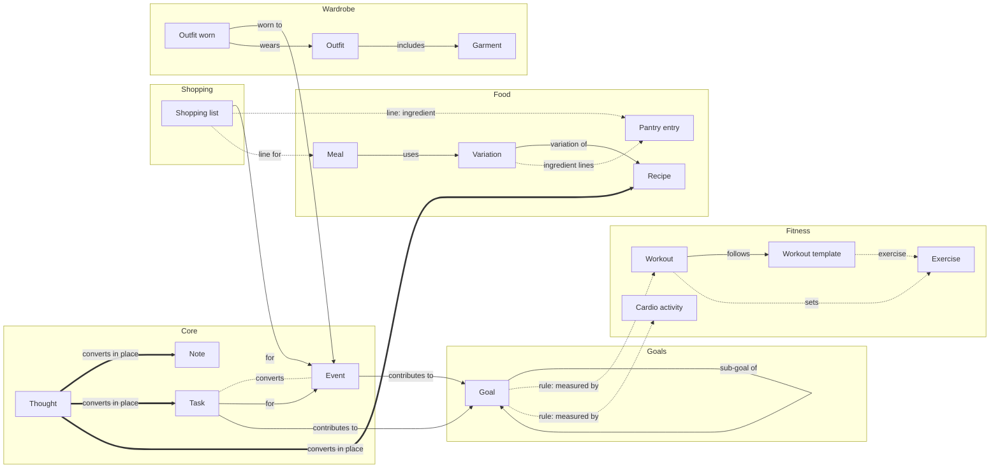
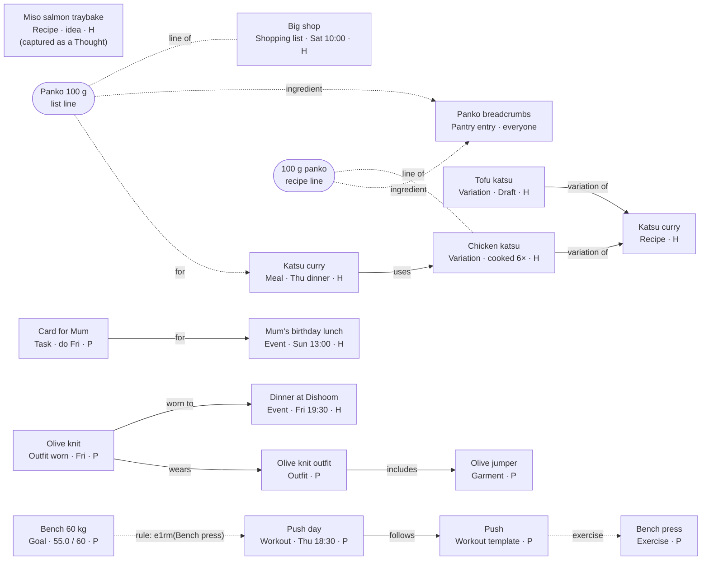

# Data model

*Written by hand until the ontology package generates it
([ADR-0036](adr/0036-changing-the-model-over-time.md)). The core Types
(Thought, Note, Task, Event), their link types and conversions are already
declared in [`packages/ontology`](../../packages/ontology/src/), which is the
authority for them; this document must agree with it. The shape is
Provisionally agreed, through the ADRs it cites; column-level detail is a
draft that each stage's spec confirms. Types for later stages are listed so
the whole shape is visible; each is built only in its own stage.*

## Three mechanisms

*([ADR-0005](adr/0005-traits-links-rules.md), Provisionally agreed)*

1. **Traits — what an Item *is*.** Types have traits: *Schedulable* (has a
   time), *Completable* (can be ticked off), *Shareable* (can belong to the
   Household Space), *Capturable* (a Thought can become one in place).
   **Views are queries over traits.** Plan = Schedulable Items in a date
   range; the Gym View = Items of workout Types. A new Schedulable Type
   appears on Plan with no extra work. ("Gym session *can be viewed on* Plan"
   is therefore a query, not a link.) There is no *Measurable* trait: what
   goals can measure is the measures registry's job.
2. **Links — how two specific Items relate.** Named in both directions
   ("uses" / "used in"), with rules about which Types each link type may
   connect, like a DOORS link module.
3. **Rules — relationships that are calculated, not stored.** A goal like
   *Bench 60 kg* holds a measurement rule (best estimated 1RM for bench
   press); its contributing sessions are whatever the rule finds. Nobody links
   sessions to goals by hand.

**The action creates the link.** Converting a Thought keeps the same Item, so no
link is needed; *became* is created only when a new Item is made from an old
one.

## Concepts at a glance

| Concept | What it is | Stored as |
|---|---|---|
| Item | A node in the graph | `core.items` + a detail table per Type |
| Type | What kind of Item | Code constant, copied to a lookup table |
| Trait | A capability of a Type | Part of the Type's declaration |
| Status | `idea · active · done · cancelled`, labelled per Type | `core.items.status` |
| Link / link type | A named edge between two Items | `core.links` + code constant |
| Child row | Part of one Item, not an Item | Module tables |
| Reference data | A Module's lookup list (muscle groups, cuisines, brands…) | Module lookup tables |
| Label | A per-Space grouping on the Types that use one: it filters Inbox, Notes and Tasks | `core.labels`, `core.item_labels` |
| Mark | A per-person flag under the Type's own name: pinned, starred, favourited | `core.marks` |
| Series | A repeat rule that generates occurrences | `core.series` |
| Reminder | A per-person notification on an Item | `core.reminders` |
| Space | Personal or Household | `core.spaces`, `core.space_members` |
| Measure | Something a goal can track | SQL function named in code |
| View / Screen | A query + layout / a workflow page | Code |
| Integration | An outside source | `core.connections`, `core.external_refs` |
| Activity | What happened to which Item, when | `core.activity` (triggers) |

## Storage shape

*([ADR-0007](adr/0007-storage-shape.md), Provisionally agreed)*

A shared core table plus per-type detail tables ("class table inheritance"),
modelled in ordinary Postgres tables plus a links table:

```
core.items     id (UUIDv7, made on the device), type, title, body, space_id,
               owner_id, status, starts_at, ends_at, all_day, due_on (date),
               do_on (date) + do_at (optional time), slot, place, series_id +
               occurrence_on, position, touched_at, search, created_at,
               updated_at, archived_at
               (only the fields every View filters on)

<type> detail  1:1 with items, per Type, in its Module's schema, e.g.
               fitness.workout(item_id, actual_start, duration, readiness …)
               food.meal(item_id, servings)
               shopping.shopping_list(item_id, place)

child rows     belong to one Item and are not Items themselves:
               workout_sets, variation_ingredients, shopping_lines …

core.series    type, space, owner, the repeat rule (an RRULE), mode
               (schedule | after completion), starts_on, timezone, template
               (what each occurrence is made with: a Task's do_at and due
               offset, an Event's start time and length, or all day and its
               number of days), generated_until, ended_on
core.links     from_item, to_item, link_type, origin (manual|action|integration) …
core.reminders item_id, person, anchor (starts_at|do_on|due_on) + days
               and a time, or minutes before an Event's start
               (offset_minutes), or a fixed time; the default time it was made with;
               is_default; snoozed_until; fires_at (calculated)
core.activity  item_id, verb, changed (jsonb), at, actor — written by triggers
```

- **An Item's body is Markdown** (a Note's lists, checklists and emphasis,
  [ADR-0046](adr/0046-note-bodies.md)).
- **Types, link types and measures are declared in code**; a generated
  migration copies Types and link types into lookup tables so the database
  can enforce which Types a link may connect
  ([ADR-0008](adr/0008-registries-declared-in-code.md)).
- **Status is one small core set:** `idea | active | done | cancelled`. Each
  Type uses the subset that applies, with its own labels. Finer states, such
  as a workout in progress, live in the detail table. Only Completable Types
  use *done*.
- **IDs are made on the device** (UUIDv7, so they sort by creation time).
  Postgres 17 has no built-in `uuidv7()`, so server-side inserts use a small
  SQL function, `core_private.uuidv7()`.
- **`do_on` is a date with an optional time.** A Task is something *you do*,
  by or on a date; an Event is something that *happens* at a time. "Sat 10:00
  Tesco" is a Shopping list with a do-on time; "Dishoom 19:30" is an Event.
- **`touched_at`** is set the first time a person edits, ticks, labels,
  adds a sub-task to or links an occurrence; what the series itself writes
  doesn't count ([ADR-0022](adr/0022-repeating-items.md)).
- **An occurrence is unique by its series and `occurrence_on`**, the date
  the series made it for, which stays put when the occurrence is moved
  ([ADR-0045](adr/0045-extending-series.md)).
- **`position`** is a hand-made order within a group (TSK-012), a text key
  that sorts between its neighbours.
- **`search`** is the search index (titles, Labels, bodies), kept by
  triggers and never sent to the app (SRC-001).
- **`updated_at`** moves only when something people see changes, not when
  the search index or `touched_at` is refreshed; the activity log ignores
  those two as well.
- **Writes that span tables are database functions** called over RPC
  ([ADR-0009](adr/0009-cross-table-writes-are-database-functions.md));
  [ADR-0042](adr/0042-data-layer.md) makes every write one.

### Time fields per Schedulable Type

Plan shows an Item on the first of these it has: `starts_at` (as a local
date), `do_on`, `due_on`. A `CHECK` per Type refuses the fields it doesn't
use.

| Type | Time fields | Reminder anchors |
|---|---|---|
| Task | `do_on` + `do_at`, `due_on` | `do_on`, `due_on` |
| Event | `starts_at`, `ends_at`, `all_day` | `starts_at` |
| Shopping list (when dated) | `do_on` + `do_at` | `do_on` |
| Meal | `do_on` + `slot` | `do_on` |
| Workout, Cardio activity | `starts_at` (planned; what happened is in the detail table) | `starts_at` |
| Outfit worn | `do_on` | `do_on` |
| Goal | none: its deadline is in `goals.goal`, so a Goal is not on Plan | — |

Task ↔ Event maps `do_on` + `do_at` to `starts_at` (an hour long; all day
when there is no time), in the owner's timezone, and back. **An all-day Event keeps its days as dates**: `starts_at` is
midnight UTC of its first day and `ends_at` midnight UTC of the day after its
last, as Google keeps them, so it is the same days in any timezone (EVT-001).
Plan reads a date range through `core.plan_items` ([ADR-0049](adr/0049-plans-read.md)).

## Item or child row?

An Item if it needs to be **linked, scheduled, shared or searched on its
own**; otherwise a child row. A child row may *point at* an Item without being
one: a set points at its Exercise; a recipe line points at its Pantry entry; a
list line can point at both the Pantry entry it is and the Meal it is for
("Panko · for Katsu, Thu"). Garments are Items, because outfits link to them.
**The Pantry is neither:** a catalogue of ingredients and household items
shared by everyone in LifeOS, each entry with whoever added it; many lines
point at one entry, and staples are each Household's
([ADR-0051](adr/0051-who-sees-food.md), Provisionally agreed).

## Definition → occurrence

*([ADR-0013](adr/0013-occurrences-snapshot-their-definition.md), Provisionally agreed)*

| Definition | Occurrence | Link | Snapshot copied |
|---|---|---|---|
| Variation (of a Recipe) | Meal | *uses* | Servings and, once added to a list, the scaled quantities on its list lines |
| Workout template | Workout | *follows* | Each exercise's targets, at the start of the session |
| Outfit | Outfit worn on a day | *wears* | The garments in the outfit on the day |
| Series (repeat rule) | Each occurrence | `series_id` | The series' fields, when generated |

Planning is mostly *creating occurrences of definitions*. History is read
from the copy, never from the definition's current values.

## Types

S = Schedulable · C = Completable · Sh = Shareable · Cap = Capturable.
Colour: the Type's colour ([ADR-0043](adr/0043-colour-by-type.md),
Provisionally agreed). Labels: whether the Type uses Labels. Mark: the
per-person mark the Type has, under its own name. The ontology package also
declares which Types hold sub-tasks (Task) and which time field a Type's
default Reminder follows (a Task's do-on date; an Event's start, 30 minutes
before) and which have a place (Event); the lookup table carries all of
these, so the database enforces them.

| Module | Type | S | C | Sh | Cap | Default Space | Statuses used (labels) | Colour | Labels | Mark | Stage |
|---|---|---|---|---|---|---|---|---|---|---|---|
| core | **Thought** (raw, unsorted; waits in Inbox until sorted or ticked off) | — | ✓ | — | — | Personal | active · done | yellow | ✓ | — | 2 |
| core | **Note** | — | — | — | ✓ | Personal | active | yellow | ✓ | pinned | 2 |
| core | **Task** | ✓ do-on / due | ✓ | ✓ | ✓ | Personal | idea "Someday" · active · done · cancelled (a missed repeat: "Skipped") | blue | ✓ | starred | 2 |
| core | **Event** (a place; not captured, but a Thought can become one) | ✓ start / end | — | ✓ | ✓ | Personal ("with household" → Household); from Google Calendar always Personal | active · cancelled | blue | ✓ | — | 3 |
| shopping | **Shopping list** (a date is optional; a standing list has none) | ✓ do-on, place (optional) | ✓ | ✓ | ✓ | Household | active · done · cancelled | yellow | — | — | 4b |
| food | **Recipe** (the dish) | — | — | ✓ | ✓ | Its author's Personal, seen read-only by their Household ([ADR-0051](adr/0051-who-sees-food.md)) | idea "Idea" · active "Draft" · done "Complete" · cancelled "Archived" — the highest of its Variations', worked out | green | — | favourited | 4 |
| food | **Variation** (a way of making it) | — | — | ✓ | — | Its own author's: the Recipe's, or a Household member's added to it (ADR-0051) | idea "Idea" · active "Draft" · done "Complete" · cancelled "Archived", set by hand | green | — | — | 4 |
| food | **Meal** (or a typed Meal, or leftovers of one) | ✓ do-on + slot | ✓ "eaten" (logs no cook) | ✓ | — | Household when in one, else Personal | active "Planned" · done · cancelled | green | — | — | 4 |
| fitness | **Exercise** | — | — | — | — | Personal | active | coral | — | — | 5 |
| fitness | **Workout template** | — | — | — | — | Personal | active | coral | — | — | 5 |
| fitness | **Workout** | ✓ start | ✓ | — | — | Personal | active "Planned" · done · cancelled "Skipped" | coral | — | — | 5 |
| fitness | **Cardio activity** | ✓ start | ✓ | — | — | Personal | active "Planned" · done · cancelled "Skipped" | coral | — | — | 8 (manual entry earlier if wanted) |
| goals | **Goal** | — (deadline in `goal`; not on Plan) | ✓ | ✓ | ✓ | Personal | idea · active · done "Achieved" · cancelled "Abandoned" | purple | — | — | 5 |
| wardrobe | **Garment** | — | — | — | ✓ | Personal | idea "Wishlist" · active "Owned" · cancelled "Retired" | orange | — | — | 6 |
| wardrobe | **Outfit** | — | — | — | — | Personal | idea · active | orange | — | — | 6 |
| wardrobe | **Outfit worn** | ✓ do-on | ✓ "worn" | — | — | Personal | active "Planned" · done · cancelled | orange | — | — | 6 |
| finance | **Account** | — | — | ✓ | — | Personal | active · cancelled "Closed" | Stage 9 | — | — | 9 |

Shopping list: [ADR-0050](adr/0050-shopping-list.md) (Provisionally agreed), superseding ADR-0010's List and Shop.
Recipe and Variation: [ADR-0011](adr/0011-recipe-and-variation.md) (Provisionally agreed).
Ingredient lines and the Pantry: [ADR-0012](adr/0012-ingredients-and-shopping-lists.md), [ADR-0051](adr/0051-who-sees-food.md) (Provisionally agreed).

**In-place conversions:** Thought → any Capturable Type (sorting the Inbox);
Note → any other Capturable Type; Task ↔ Event. Everything else is "create from" + *became*
([ADR-0018](adr/0018-changing-an-items-type.md), Provisionally agreed).
Thoughts and Notes: [ADR-0037](adr/0037-thoughts.md) (Provisionally agreed).

**Not Items, deliberately:** people, Spaces, series, Reminders, Labels,
marks, sub-tasks,
reference data, list lines, ingredient lines, method steps, cook log entries,
template exercises, workout sets, health metrics (Oura sleep and readiness,
weight — a time series; [ADR-0015](adr/0015-health-data-as-a-time-series.md),
  Provisionally agreed), account balances and transactions (later).

**Possible later Types:** Place (for location Reminders and "Tesco"), Trip,
Body measurement if it ever needs linking, Project (if grouping Tasks needs
more than Labels).

## Detail tables and child rows

| Module | Detail tables (1:1 with an Item) | Child rows |
|---|---|---|
| core | — (Thought, Note, Task use `core.items` only; where an Event's place is kept is decided with Stage 3's schema) | `subtasks(item_id, title, done, position)` — a Task's sub-tasks |
| shopping | `shopping_list(place)` | `shopping_lines(text, ingredient_id?, qty, unit, section, checked, position, for_item_id?, generated, touched_at)` |
| food | `recipe(photo, category, cuisine, default_variation)`, `variation(name, servings, prep_min, cook_min, sources, notes)`, `meal(servings, leftovers_of?, typed_title?)` | `variation_ingredients(ingredient_id?, text?, qty, qty_max?, approx, unit, heading?, position)`, `variation_steps`, `cook_log(person, cooked_on, verdict, notes, servings, snapshot)`; the Recipe's tags, protein and carbs; reference data: categories, cuisines, tags, protein, carbs; the Pantry `pantry(name, kind: ingredient · household, aisle, default_unit, added_by)` and each Household's `staples(entry, out_of_stock)` (all subject to the Stage 4 specs) |
| fitness | `exercise(muscle_groups, equipment, increment, target)`, `workout(actual_start, duration, readiness, stage)`, `cardio_activity(kind, distance_m, duration_s, avg_hr)` | `template_exercises(exercise_id, sets, reps, target)`, `workout_entries(exercise_id, snapshot)`, `workout_sets(entry_id, set_no, reps, weight, rpe)`; reference data: muscle groups, equipment, recovery settings per person |
| goals | `goal(kind, measure_key, params, target, unit, period, start_on, deadline)` | — |
| wardrobe | `garment(category, brand, colour, size, fit, photo, url, price)`, `outfit(photo)` | `outfit_worn_garments` (the snapshot); reference data: category, brand, colour, size, fit |
| health (later) | — | `daily_metrics(person, date, sleep_score, readiness, steps, weight …)` |
| finance (later) | `account(provider, kind, currency)` | `balances(date, amount)`, `transactions` |

## Link types

| Link type | From → To | Inverse label | Created by |
|---|---|---|---|
| **uses** | Meal → Variation | used in | Planning a recipe |
| **follows** | Workout → Workout template | followed by | Starting from a template |
| **wears** | Outfit worn → Outfit | worn on | Planning an outfit |
| **includes** | Outfit → Garment | in outfit | Building an outfit |
| **worn to** | Outfit worn → Event | outfit | Picking an outfit for an event |
| **for** | Task / Shopping list → Event | to do for | Hand, or capture ("card for mum's lunch") |
| **contributes to** | Task / Event / Shopping list / Workout / Cardio activity → Goal | contributors | Hand (counted only by milestone goals) |
| **sub-goal of** | Goal → Goal | sub-goals | Hand (one level) |
| **became** | any → any | came from | "Create from" |
| **variation of** | Variation → Recipe | variations | Creating a Recipe (its first Variation) or "Make a variation"; exactly one per Variation ([ADR-0011](adr/0011-recipe-and-variation.md), Provisionally agreed) |
| **relates to** | any ↔ any | relates to | Hand — the catch-all |

Child-row pointers that are not links: a list line's `for_item_id` (→ Meal or
Event) and `ingredient_id` (→ Pantry entry), a recipe line's `ingredient_id`
(→ Pantry entry), a cook log entry's `meal_id` (→ Meal), and a set's or
template line's `exercise_id` (→ Exercise). Goal measures find their Items by
rule and create no links.

## Measures (examples)

| Measure | Used by |
|---|---|
| `fitness.e1rm(exercise)` — best estimated 1RM | Target goals |
| `fitness.workouts_done(period, template?)` | Habit goals |
| `fitness.volume(exercise, period)` | Total goals |
| `cardio.distance(kind, period)` | Total goals |
| `cardio.activities(kind, period)` | Habit goals |
| `food.new_recipes_cooked(period)` — from the cook log, with or without a Meal | Total goals |
| `food.cooks(period)` — from the cook log | Habit goals |
| `core.tasks_done(period, filter?)` | Total / habit goals |
| `health.latest(metric)` (later) | Target goals (weight) |
| `finance.balance(accounts)` (later) | Target goals (ISA total) |

## Core tables

| Table | Holds |
|---|---|
| `core.people` | A person: name, home timezone, default Reminder time (09:00), whether each Type's default Reminder is on, the morning digest and its time (07:00), the Types hidden on Plan (PLN-004); later, food preferences |
| `core.spaces` · `core.space_members` · `core.space_invites` | Personal and Household Spaces; membership, each member owner or member (a person may be in several Households); invitations by email, waiting for that address to sign in ([ADR-0039](adr/0039-accounts-contacts-households.md)) |
| `core.items` | Every Item |
| `core.series` | Repeat rules for generated occurrences |
| `core.links` | Every link |
| `core.reminders` · `core.reminder_deliveries` | Reminders per person, each Item's default one kept by a trigger (made when it gains the date, gone when the date is cleared), `fires_at` worked out in the person's timezone; one row per notification and device — a Reminder, the morning digest or an overdue nudge — with when it was sent, or why not (missed, skipped), and a token for its buttons ([ADR-0044](adr/0044-reminder-delivery.md), Provisionally agreed) |
| `core.push_devices` | Web Push (later FCM) subscriptions per person; a device the push service says is gone is no longer sent to |
| `core.inbox_state` | Per-person dismiss / snooze of Inbox entries |
| `core.activity` | The activity log, written by triggers: `created`, `updated`, `converted`, `archived`, `restored`, `linked`, `unlinked`, with the changed fields |
| `core.item_types` · `core.link_types` | The ontology's lookup tables, generated from `packages/ontology` ([ADR-0008](adr/0008-registries-declared-in-code.md)) |
| `core.labels` · `core.item_labels` | Labels: one set per Space, names unique whatever their case, only on the Types that use them and from the Item's own Space; renaming shows everywhere, deleting keeps the Items. A Label made under a name already taken keeps the new id in its `aliases`, so a device that made it offline still gives and takes it off |
| `core.marks` | Per-person marks: pinned Notes, starred Tasks, favourited Recipes. A converted Item keeps its mark if the new Type has one (a pinned Note becomes a starred Task), and its Labels if the new Type uses them |
| `core.subtasks` | A Task's sub-tasks: title, done, position |
| `core.capture_tokens` | Each person's capture-address secrets (hashed), revocable (Stage 10) |
| `core.attachments` | Photos and files on Items (Supabase Storage) |
| `core.connections` | Integration connections; tokens in Vault. A disconnected one is kept, emptied (`disconnected_at`), so reconnecting finds its calendars and outside ids again |
| `core_private.oauth_states` | One-time states for connecting an Integration: whose, where the app was, when used; then the token waiting in Vault and the one-time code the person who began finishes with (Stage 3) |
| `core.external_refs` | Integration ids and raw payloads per Item: its connection and calendar, the outside id and `etag`, the raw payload and the mapping's version, and whether the Item was made in LifeOS and sent out (`made_in_lifeos`: it stays mine when the calendar goes) |
| `core.calendar_links` | Each Google calendar of a connection: its sync level, whether it is my default calendar (`new_events`), its sync token (Stage 3, [ADR-0047](adr/0047-google-calendar-sync.md), Provisionally agreed) |
| `core_private.calendar_outbox` | Events and repeating Events waiting to go to Google on a two-way calendar: one waiting row each, when it was queued, its tries and when to try next, when sent and why it failed (Stage 3, [ADR-0048](adr/0048-google-calendar-two-way.md), Provisionally agreed) |
| `core_private.event_calendars` | The calendar chosen for a new Event as it was made, or none (GCL-005 1, ADR-0048) |
| `core_private.series_refs` | Which Google repeating event each series sent to Google is, with its `etag` (ADR-0048) |
| `ops.events` | Errors and failures from the app, Edge Functions, cron jobs and Integrations: what, where (screen), the last few actions, never Items' content |
| `ops.health_runs` · `ops.heartbeats` | The nightly health check's findings; when jobs outside the database last ran: Reminder sending and the nightly series run ([ADR-0044](adr/0044-reminder-delivery.md), [ADR-0045](adr/0045-extending-series.md)) |

## The knowledge graph, drawn

Two diagrams of the same model. In MBSE terms, the first is the **metamodel**
(which Types exist and how they may link) and the second is a **model** built
from it (one real week). A hand-drawn interactive version is frozen in
[history](../history/2026-10-09-summary-knowledge-graph.html) and not
maintained.

**Line styles:** **solid** = a stored link, created by an action ·
**dotted** = a pointer from a child row, or a Type conversion · **dashed
(`rule`)** = a goal measure, calculated, nothing stored · **thick** = a Thought
converting in place (same Item, so not a link).

### The metamodel: Types and the links allowed between them



Drawn selectively to stay readable: a Thought also converts to Event,
Shopping list, Goal and Garment (every Capturable Type), and a Note to any other
Capturable Type; *contributes to* also comes from Shopping lists,
Workouts and Cardio; a Shopping list's line can point at an Event as well as
a Meal; measures also exist for Meals and Tasks. Two link types
connect any pair of Types and are not drawn: *became* and *relates to*.
Finance's Account (Stage 9) is not shown.

### The model: Thursday 8 October

H = Household Space, P = Personal.



What it shows:

- **Views are queries, not links:** Plan is every dated Item in the week
  (Meal, Shopping list, both Events, the Task, Outfit worn, Workout); nothing links to
  Plan.
- **The action creates the link:** planning the meal made *uses*; picking an
  outfit for Dishoom made *worn to*.
- **Visibility follows links, one hop:** the Household sees the shared Items
  plus the Olive knit (linked to Dishoom) and the card for Mum (linked to the
  lunch), but not the Outfit or jumper behind the Olive knit.
- **Rules expose nothing:** the goal finds Push day by its measure, and no
  link is stored.
- **A sorted Thought is the same Item:** Miso salmon was captured as a
  Thought and is now a Recipe in the *idea* status.
- **Recipe to shopping list:** the Chicken katsu Variation's "100 g panko"
  line and the Big shop's "Panko 100 g" line both point at one Pantry entry,
  and the list line is *for* Thursday's Meal, which *uses* that Variation.
  Tofu katsu has its own lines (not drawn) and is still a Draft.
