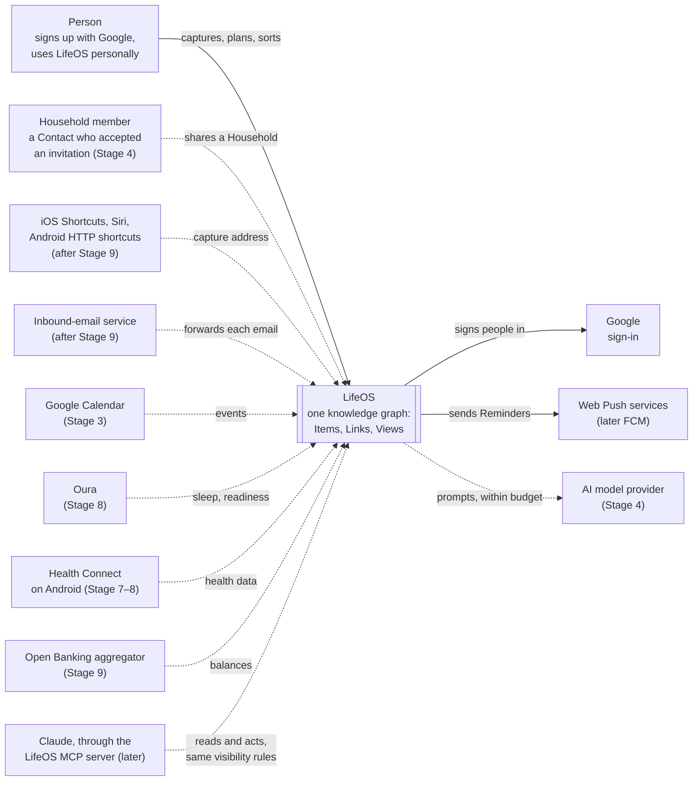
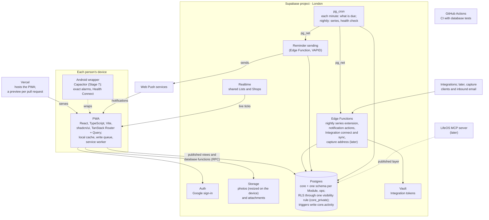

# Architecture overview

*Drawn from the ADRs. Dashed lines and "(later)" mark parts that arrive in a
later stage; where a box first appears is in the [roadmap](../roadmap.md).*

## Context: LifeOS and the world around it

## Containers: what runs where

Each Module's tables sit in its own schema and are read by other Modules only
through published views and functions ([contracts](contracts.md)). Errors
from every box are reported to `ops.events`
([runbook](../40-operations/runbook.md)).

## The shape

- **One model, many views.** The life data is a knowledge graph — Items,
  Links, and an ontology of Types, Traits and link types
  ([vision](../00-foundation/vision.md),
  [data model](data-model.md)).
- **Modelled in Postgres**, as ordinary tables plus a links table, and
  exportable as a graph whenever wanted (visualisation, AI). RDF/SPARQL triple
  stores and graph databases (Neo4j) were rejected: too heavy for a personal
  app, not hosted by Supabase, and LifeOS's queries are mostly shallow and
  time-based ([ADR-0007](adr/0007-storage-shape.md), Provisionally agreed).
- **A small core plus Modules**, one Postgres schema per area, and one
  pattern for every Integration ([principles](../00-foundation/principles.md),
  [contracts](contracts.md)).

## Core, Modules and Integrations

| Part | Owns |
|---|---|
| **Core** | Identity, Spaces, Items and Links, Reminders and notifications, capture, search, the activity log, caching and sync; the Thought, Note, Task and Event Types; the shared AI service |
| **Modules** | `lists` (List, Shop), `food` (Recipe, Variation, Meal, Ingredient), `fitness` (Exercise, Workout template, Workout, Cardio activity), `goals` (Goal), `wardrobe` (Garment, Outfit, Outfit worn), later `health` and `finance` |
| **Integrations** | Google Calendar, Oura, Health Connect, later banks |

## Moving parts

- **The app:** an installable PWA, deployed on its own Vercel project.
- **Supabase:** Postgres, Edge Functions, `pg_cron`, Vault, Storage and
  Realtime.
- **GitHub Actions:** CI. No backups for now
  ([backups](../40-operations/backups.md)).
- **Later:** a LifeOS MCP server on the published layer; a Capacitor Android
  wrapper; after Stage 9, an inbound-email service for the capture address
  ([ADR-0028](adr/0028-capture-from-outside-the-app.md)).

## Stack

*([ADR-0034](adr/0034-stack.md), Provisionally agreed)*

- React + TypeScript + Vite, as an installable PWA;
- Tailwind v4 and **shadcn/ui on Base UI** (the shadcn default for new
  projects since July 2026, with Radix still supported);
- TanStack Router;
- TanStack Query behind one data layer, keeping the option of PowerSync +
  TanStack DB ([ADR-0042](adr/0042-data-layer.md));
- Supabase, including Edge Functions, pg_cron and Vault;
- Capacitor later.

## Platforms

- **Web-first.** Joe's girlfriend uses the installed PWA on iOS:
  - Web Push works for home-screen apps since iOS 16.4, without action
    buttons.
  - iOS has **no share target, no home-screen shortcuts and no Background
    Sync**, so queued writes send when the app is next open.
- **Android wrapper (Capacitor)** — moderate effort, and the only route to
  alarm-grade Reminders:
  - Since Android 14, `SCHEDULE_EXACT_ALARM` is denied by default. Calendar
    and reminder apps may declare **`USE_EXACT_ALARM`**, granted at install.
    That's fine for an app installed directly; Google Play restricts it to
    alarm and calendar apps.
  - The hard part is getting Reminders created elsewhere onto the phone. The
    usual pattern is a high-priority FCM data message that schedules the alarm
    on the device.
- **iOS native** would need a Mac and £79/yr, so it isn't planned.

## Sources

[Supabase custom schemas](https://supabase.com/docs/guides/api/using-custom-schemas) ·
[Radix → Base UI default](https://blog.openreplay.com/shadcn-ui-radix-base-ui-switch/) ·
[PowerSync + TanStack DB](https://www.powersync.com/blog/offline-first-apps-with-tanstack-db-and-powersync) ·
[Android 14 exact alarms](https://developer.android.com/about/versions/14/changes/schedule-exact-alarms) ·
[Capacitor local notifications](https://capacitorjs.com/docs/apis/local-notifications) ·
[iOS PWA limitations](https://www.magicbell.com/blog/pwa-ios-limitations-safari-support-complete-guide)
